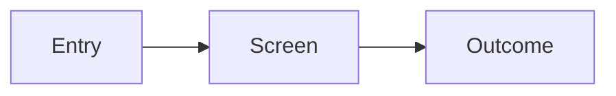

# DES-XXX: <feature name>

Status: Draft · Requirement: [REQ-XXX](../01-requirements/REQ-XXX-slug.md)

## Screens

| Screen | Route  | testID (title)   | Purpose |
| ------ | ------ | ---------------- | ------- |
|        | `/...` | `<screen>-title` |         |

## Flow

## States per screen

| Screen | Loading | Empty | Error | Success |
| ------ | ------- | ----- | ----- | ------- |
|        |         |       |       |         |

## Components

<!-- Reuse @starter/ui (Button, TextField, ThemedText/View, tokens) first. New shared components go in packages/ui/src/components. -->

## Web layout

<!-- Platforms web/both: how the screen sits in the web shell (sidebar ≥ 768px, menu below). Same testIDs. -->

## Copy

| i18n key (`<feature>:<key>`) | Text |
| ---------------------------- | ---- |

## Accessibility

- Labels / roles:
- Focus order:

## Mockups

<!-- Link Figma, or attach images in docs/03-design/assets/. -->
