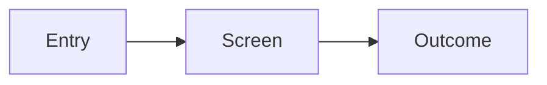

# DES-XXX: <feature name>

Status: Draft · Requirement: [REQ-XXX](../01-requirements/REQ-XXX-slug.md)

## Screens

| Screen | Route  | testID (title)   | Purpose |
| ------ | ------ | ---------------- | ------- |
|        | `/...` | `<screen>-title` |         |

## Flow

## States per screen

| Screen | Loading | Empty | Error | Success |
| ------ | ------- | ----- | ----- | ------- |
|        |         |       |       |         |

## Components

<!-- Reuse from src/components first. New shared components go in src/components/ui. -->

## Copy

| Key | Text |
| --- | ---- |

## Accessibility

- Labels / roles:
- Focus order:

## Mockups

<!-- Link Figma, or attach images in docs/03-design/assets/. -->
